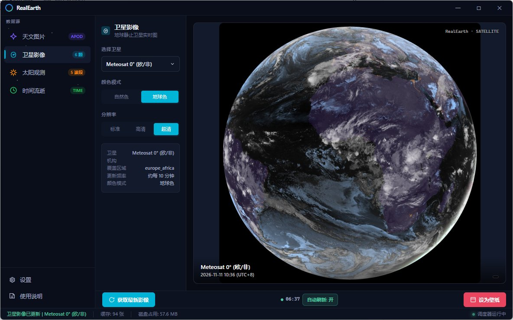
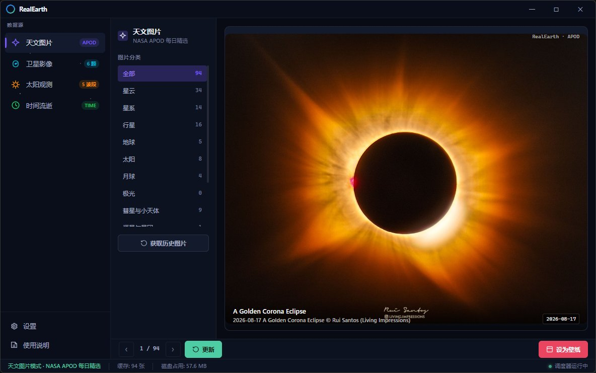
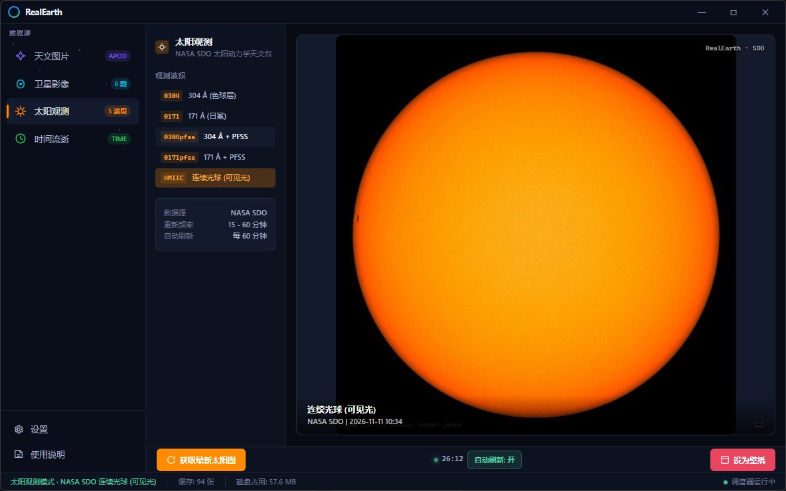
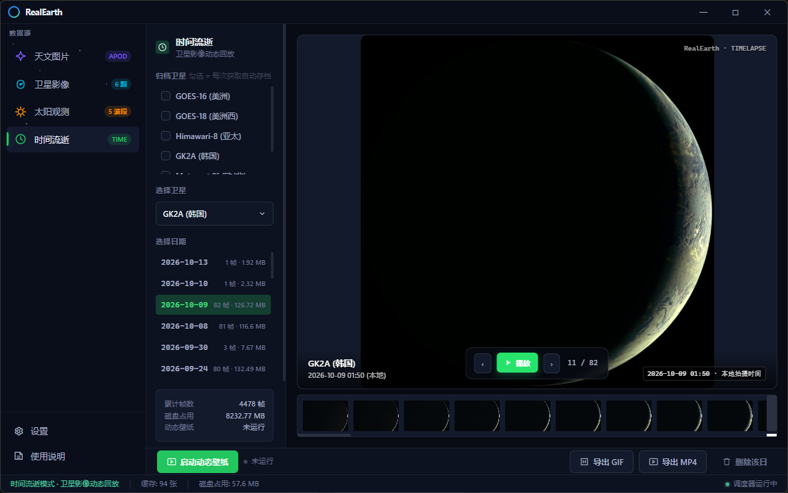

# LivingEarth Wallpaper

[](https://www.python.org/)
[](LICENSE)

多数据源 Windows 桌面壁纸软件，支持 **NASA 天文图片 (APOD)**、**地球静止卫星实时影像**、**NASA SDO 太阳观测** 与 **卫星影像时间流逝 / 动态壁纸**。

基于 [Live-Earth-Wallpapers](https://github.com/lennart-rth/Live-Earth-Wallpapers) 的卫星数据源架构，使用 CIRA RAMMB-Slider 获取多颗地球静止卫星的实时影像。

## 软件截图

| 🛰 卫星影像 | 🔭 天文图片 (APOD) |
|:---:|:---:|
|  |  |
| **☀ 太阳观测 (SDO)** | **⏱ 时间流逝 / 动态壁纸** |
|  |  |

*深空暗色界面 · 左侧数据源切换 · 中间参数面板 · 右侧实时预览*

## 功能特性

### 🔭 NASA APOD 模式
- 自动获取 NASA 天文每日图片 (Astronomy Picture of the Day)
- **10 个智能分类**：星云、星系、行星、地球、太阳、月球、极光、彗星、恒星、空间站
- 基于关键词匹配自动分类，切换类别即可浏览对应图片

### 🛰 卫星影像模式
- 支持 **6 颗地球静止卫星**：
  - GOES-16 (美洲)、GOES-18 (美洲西)
  - Himawari-8 (亚太)、GK2A (韩国)
  - Meteosat-0deg (欧洲/非洲)、Meteosat-9 (印度洋)
- 颜色模式：自然色 / 地球色 (含夜景)
- 分辨率可选：标准 / 高清 / 超清（瓦片拼接）
- 基于 **CIRA RAMMB-Slider** 数据
- 每 10 分钟自动刷新

### ☀ 太阳观测模式
- 数据来源：**NASA SDO** (Solar Dynamics Observatory)
- 多波段支持：304 Å (色球层)、171 Å (日冕)、连续光球 (太阳黑子)、带磁场线叠加
- 约每 15-60 分钟更新一张

### ⏱ 时间流逝 / 动态壁纸
- 卫星影像自动归档与回填，按日期回放（GK2A 单日可达 80+ 帧）
- **动态壁纸**：嵌入桌面 WorkerW 层，桌面图标正常可见、不被遮挡
- 支持 GIF / MP4 导出，帧率与播放速度可调

### 🖼 壁纸设置
- 支持多种壁纸样式：居中、平铺、拉伸、适应、填充
- 壁纸右上角自动标注来源和拍摄时间
- Windows 注册表控制壁纸样式

### ⚡ 后台运行
- 点击关闭按钮弹出选择对话框："最小化到任务栏" 或 "退出程序"
- 最小化后调度器在后台持续运行，自动更新壁纸

## 系统要求

- **操作系统**: Windows 10/11
- **Python**: 3.10+
- **依赖**: `requests`, `Pillow (PIL)`, `pywebview`（详见 `requirements.txt`）

## 安装 & 运行

### 方式一：源码运行

```bash
git clone https://github.com/suika3733/LivingEarth-Wallpaper.git
cd LivingEarth-Wallpaper

# 安装依赖
pip install -r requirements.txt

# 运行
python main.py
```

### 方式二：打包为 EXE

```bash
pip install pyinstaller
pyinstaller "LivingEarth Wallpaper.spec"
```

### 方式三：直接下载

从 [Releases](https://github.com/suika3733/LivingEarth-Wallpaper/releases) 页面下载 `LivingEarth-Wallpaper.exe`，双击运行，无需安装。

> 首次启动会自动获取近 10 天的 NASA APOD 图片到本地缓存。

## 项目结构

```
├── main.py              # 主程序入口 (pywebview 窗口)
├── backend.py           # 后端 API (前后端桥接)
├── providers/           # 数据源提供商
│   ├── geostationary.py # 地球静止卫星 (RAMMB-Slider)
│   └── sdo.py           # NASA SDO 太阳图像
├── nasa_api.py          # NASA APOD API
├── timelapse_player.py  # 时间流逝 / 动态壁纸播放器 (WorkerW 嵌入)
├── archive.py           # 卫星影像归档
├── backfill.py          # 历史影像回填
├── export.py            # GIF / MP4 导出
├── wallpaper.py         # Windows 壁纸设置 + 水印
├── scheduler.py         # 后台调度器
├── config.py            # 配置管理
├── web/                 # 前端界面 (HTML/CSS/JS)
└── requirements.txt     # Python 依赖
```

### 数据存储

所有运行数据存储在 `%USERPROFILE%\.nasa_wallpaper\` 目录：

| 路径 | 说明 |
|------|------|
| `config.json` | 用户配置 |
| `metadata.json` | NASA APOD 元数据 |
| `cache/` | 图片缓存 |
| `cache/satellite/` | 卫星影像缓存 |
| `cache/sdo/` | SDO 太阳图像缓存 |
| `wallpaper/` | 当前壁纸副本 |
| `watermarked/` | 带水印壁纸 |

## 数据来源

| 数据 | 来源 |
|------|------|
| 天文图片 | [NASA APOD API](https://api.nasa.gov/) |
| 卫星影像 | [CIRA RAMMB-Slider](https://rammb-slider.cira.colostate.edu) |
| 太阳图像 | [NASA SDO](https://sdo.gsfc.nasa.gov) |

## 致谢

本项目卫星数据源架构基于 [lennart-rth/Live-Earth-Wallpapers](https://github.com/lennart-rth/Live-Earth-Wallpapers) (GPL v3)。

## License

MIT License — 详见 [LICENSE](LICENSE) 文件。
